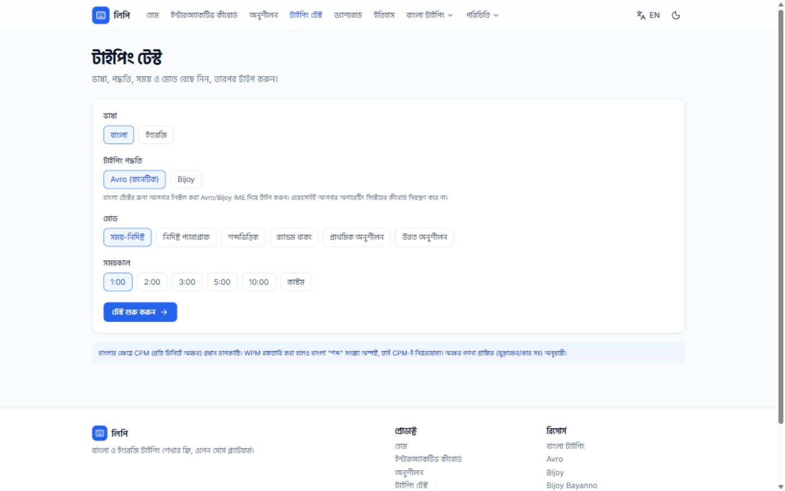
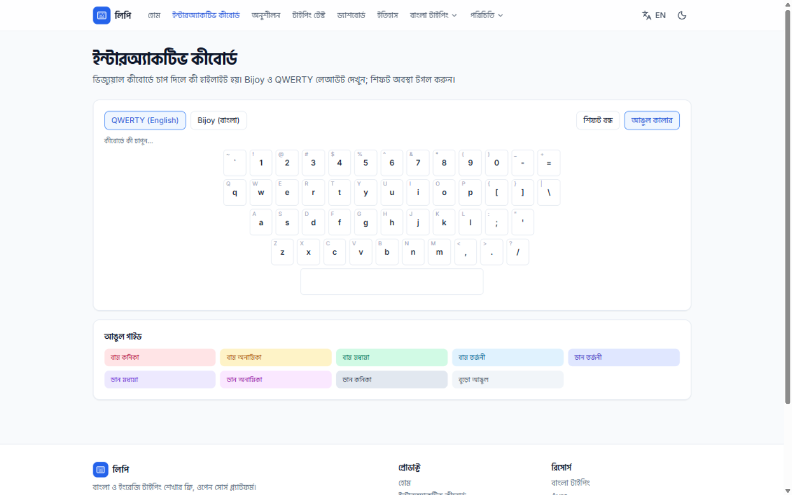

# লিপি — Lipi Typing Academy

A free, open-source, bilingual (Bangla + English) typing learning platform.
Bangla is the default interface language; everything works without an account —
all progress is stored locally in your browser.

**Live:** https://lipi-typing.vercel.app

## Features

- **Avro Phonetic course** — 6 lessons on phonetic Bangla typing (English letters → Bangla), with a simplified live converter for practice.
- **Bijoy keyboard course** — 6 lessons on the Unicode Bijoy mapping (Bangladesh's national layout, BDS 1738:2018), with an interactive visual keyboard.
- **Bijoy Bayanno guide** — install, Unicode/ANSI modes and troubleshooting, following official sources only.
- **English typing course** — 6 lessons on QWERTY, home row, finger placement and touch typing.
- **Interactive keyboard** — visual QWERTY + Bijoy layouts with finger colours, shift toggle and live key-press highlight.
- **Typing test** — language / method / mode / duration selectors, live CPM, WPM and accuracy, share & copy result, localStorage history.
- **Dashboard & history** — lesson progress, best speed, average accuracy, recommended next lesson.
- **Bilingual UI** — Bangla (default) + English via a lightweight i18n context; dark/light theme; fully responsive.

## Honest implementation notes

- The built-in Avro converter (`avroConvert` in `src/data/avroLayout.ts`) is a
  **simplified learning tool** — a longest-match approximation, **not** the full
  Avro engine. For real phonetic typing, install [Avro Keyboard](https://omicronlab.com/avro-keyboard.html)
  (OmicronLab) or an IME that bundles the Avro Phonetic engine.
- Lipi does **not** bundle, mirror or redistribute Bijoy software or its
  proprietary fonts. Bijoy / Bijoy Bayanno are products of Ananda Computers —
  see the [official site](https://www.bijoyekushe.net.bd/) and the in-app
  [References page](https://lipi-typing.vercel.app/references).
- Typing speed is measured **per grapheme cluster** (`Intl.Segmenter`), so Bangla
  conjuncts (যুক্তাক্ষর) and vowel signs count as one character. **CPM is the
  primary metric for Bangla** — WPM is shown too, but a Bangla "word" is
  ambiguous, so CPM is the reliable number.

## Screenshots

| Home | Typing Test | Interactive Keyboard |
| --- | --- | --- |
|  |  |  |

## Tech stack

React 19 · TypeScript (strict) · Vite 8 · Tailwind CSS 3 · React Router 6 ·
lucide-react · Vitest + jsdom. No backend, no database, no tracking.

The bundle is kept small for low-end PCs: routes are code-split with `lazy()`,
icon imports are tree-shaken, and there are no heavy UI libraries.

## Getting started

```bash
npm install
npm run dev       # local dev server
npm run build     # type-check + production build
npm test          # Vitest unit tests
npm run lint      # oxlint
```

## Project structure

```
src/
  components/   # Layout, Navbar, Footer, TypingTest, VirtualKeyboard, LessonView, ...
  data/         # keyboard layouts, lesson data, test texts, FAQ, references
  i18n/         # bn.ts + en.ts dictionaries, I18nContext
  lib/          # typing engine (grapheme-based), progress + storage helpers
  pages/        # 15 route pages + 404
  theme/        # dark/light ThemeContext
```

## Keyboard implementation notes

- **QWERTY** layout: standard ANSI physical layout, matched by `KeyboardEvent.code`.
- **Bijoy layout**: the community/m17n **Unicode** Bijoy mapping
  (`bn-bijoyUnicode.mim`, BijoyLinux), cross-validated against published
  references. Legacy "Bijoy Classic" ANSI/font encoding is documented — not
  emulated — on the Bijoy Bayanno guide page.

## Sources & references

Every mapping, lesson and guide is verified against public sources, listed on
the [References page](src/data/references.ts) and in-app. Key ones:

- [Avro Keyboard — OmicronLab](https://omicronlab.com/avro-keyboard.html) (MPL-1.1)
- [jsAvroPhonetic](https://github.com/dipu-bd/jsAvroPhonetic) (mapping verification)
- [OpenBangla Keyboard](https://github.com/OpenBangla/OpenBangla-Keyboard) (GPL-3.0)
- [m17n bn-bijoyUnicode.mim (BijoyLinux)](https://github.com/asikdial-tech/BijoyLinux)
- [Bijoy Ekushe — Ananda Computers](https://www.bijoyekushe.net.bd/)

## Contributing

See [CONTRIBUTING.md](CONTRIBUTING.md). Bug reports and PRs are welcome —
please keep the honesty rules: no fake features, no bundled proprietary
software, bilingual UI for every string.

## License

[MIT](LICENSE) · Bijoy and Bijoy Bayanno remain proprietary software of
Ananda Computers; the Avro Phonetic scheme is by OmicronLab (MPL-1.1).
